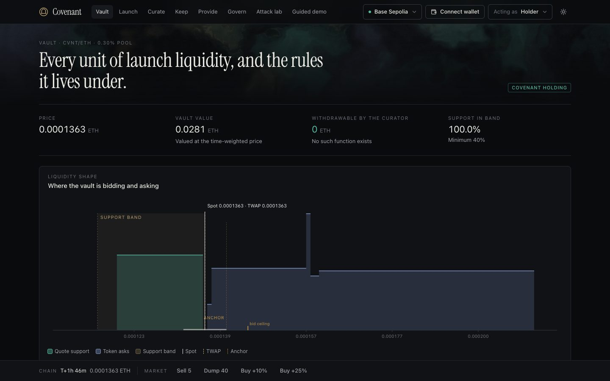
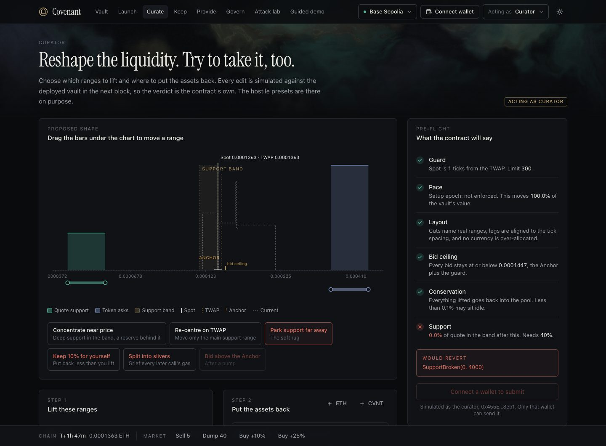
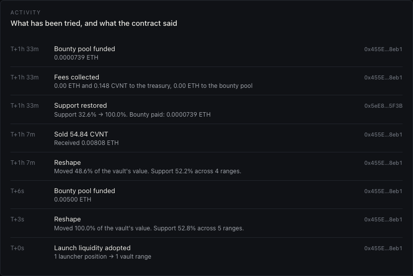

# Covenant

**Locked for holders. Managed for the market.**

A Uniswap v4 hook and vault that lets a token launch's liquidity be actively managed without ever being withdrawable.

Today a launch's liquidity is either locked, so holders know it cannot be pulled but it can never move, or handed to a manager who can move it and can also remove it. Covenant is the missing middle. The launch's LP is held by a vault under three rules fixed before the auction:

1. **Conservation.** Principal never leaves the pool before it vests. A reshape moves value between price ranges, nothing more.
2. **Support.** After any curator action, at least S% of the quote sits as bids within B ticks below the price.
3. **Pace.** The curator restructures at most M% of the vault per epoch, and a curator change takes a timelock.

A named curator reshapes freely inside those rules. If price drift breaks Support, anyone can restore it for a bounty. Outside LPs can join in kind. Covenant plugs into Uniswap's own launch stack: a Continuous Clearing Auction migrates through the stock `LBPStrategy` into a pool where Covenant is both the hook and the LP recipient. No fork of Uniswap's contracts.

The full product spec is in [`docs/SPEC.md`](docs/SPEC.md) and the execution flow in [`docs/Covenant_Flow.excalidraw`](docs/Covenant_Flow.excalidraw).

## See it

**The app, live on Base Sepolia: https://covenant-uhi11.vercel.app.** Nothing to install, and no wallet needed to look around. Every reshape drawn on Curate is simulated against the live vault, so the verdict shown is the contract's own. Keep simulates the smallest sell-off that would strand support. Connect a wallet to act.

**No wallet? Open the Playground** from the bar under the top bar. It is your own private chain on Covenant's backend,
loaded with the demo's launch, where every button sends a real transaction: act as any role, trade, move the clock,
run all 20 attacks, then reset. On Base Sepolia itself, a visitor without a wallet can also have the backend send a few
fixed actions: a poke, a fee collection, a restore when support has lapsed, a small trade, or test funds for a new wallet
([Backend](#backend)).



**The live proof.** On 2026-11-17, Covenant's rules were exercised as real transactions against the launched CVNT vault (`make proof-sepolia`; the record is [`deployments/84532.proof.json`](deployments/84532.proof.json)). The runner simulated the whole plan before sending anything, the crash included.

| Step | Transaction | What the chain recorded |
|---|---|---|
| The curator tries a soft rug | [`0x23ab6466…ccc4`](https://sepolia.basescan.org/tx/0x23ab646664a1fec895ab3cbb234d1aa92543205ce540045cd242e30b5986ccc4) ([decoded](https://base-sepolia.blockscout.com/tx/0x23ab646664a1fec895ab3cbb234d1aa92543205ce540045cd242e30b5986ccc4)) | **Reverted**: `SupportBroken(277, 4000)`. Support would have been 2.8%; the covenant needs 40% |
| The curator reshapes honestly: half the reserve four bands deep | [`0xdcf89d98…b58a`](https://sepolia.basescan.org/tx/0xdcf89d9801c7c4bc07e6a579fb3d52ab8ab9c8b9fffec50492c61284a28db58a) | Settled. Support 52.8% → 52.2%, within Pace |
| The issuer's address, standing in for the market, sells the price down | [`0xeaf892b5…fc25`](https://sepolia.basescan.org/tx/0xeaf892b56b3de475728de3958204222edca89c67b90a6ae387b75a7ba157fc25) | 54.84 CVNT sold, price 13.9% lower. After 26 minutes with nobody trading, the 30-minute TWAP had followed the price to within the guard's 300 ticks, and support had lapsed to 32.6% |
| A second address with no role in the vault restores support | [`0x76baab6f…95c1`](https://sepolia.basescan.org/tx/0x76baab6f8cc6aa702eda2636de00e74e4b19da6572974ba2f0ba2d23f6e695c1) | Support 32.6% → 100%. A 0.000074 ETH bounty paid to the caller |
| Anyone collects the fees | [`0x753e022a…30c7`](https://sepolia.basescan.org/tx/0x753e022a51ba51fdc0ef480d6b354b695a6d6d40bae332b86c06556d779730c7) | The sell-off's swap fees, 0.148 CVNT, to the treasury |
| The issuer tops the bounty pool back up | [`0x57784c77…1890`](https://sepolia.basescan.org/tx/0x57784c77ce5682e47cd72bdf117e3296a0c01254ba531b2e6b7a25e5ece11890) | By the 0.000074 ETH the keeper was paid |

The restorer's key is derived from the issuer's, to keep the demo self-contained; its gas money is [`0x521364ec…7428`](https://sepolia.basescan.org/tx/0x521364ec89da0da0670a721cc28ba93532bc766b15a5e984afef0dee87da7428). Restore is open to any address. Its bounty is capped at a share of the quote it moves, which is why this one is small: restore cannot be farmed.





**An outside LP, live.** A second launch, CVLP, has a one-hour epoch so that its rules bind within the hour. On 2026-11-17 it took an outside LP's deposit, paid the LP its share of the fees and let it leave (`npm run proof -- --lp`; the record is [`deployments/84532-lp.proof.json`](deployments/84532-lp.proof.json)).

| Step | Transaction | What the chain recorded |
|---|---|---|
| An outside LP joins, in kind | [`0xd88268b6…d599`](https://sepolia.basescan.org/tx/0xd88268b608f252dbe000545a36077a6c863786bcfd210aa7ed6aae74d5a9d599) | 0.00153 ETH and 9.67 CVLP for 9.1% of the vault's shares |
| The market buys, then sells | [`0x20659845…ae0f`](https://sepolia.basescan.org/tx/0x20659845ed521a1a406ee0673a3f0258fa88c34592ce75dd33834a653d68ae0f), [`0x4bb83c94…144f`](https://sepolia.basescan.org/tx/0x4bb83c949f39365e70867eb22cc6579ae502c84b350b8d653bf60d88fe0e144f) | 0.001 ETH of CVLP, then 6.08 CVLP back. Each trade paid the pool's 0.3% fee |
| Anyone collects the fees | [`0x522ffe59…f676`](https://sepolia.basescan.org/tx/0x522ffe59247a21d687c14399aef30662a9b7a6f489713b074ab55eb76f04f676) | The issuer's principal share: 0.0149 CVLP to the treasury, and 0.0000025 ETH to the bounty pool, which is topped up before the treasury is paid |
| The LP claims its share of the fees | [`0x240e4b22…1c50`](https://sepolia.basescan.org/tx/0x240e4b22d71c185ae1a4e596348c67b04a0c52e1c7b4015db222e14dee801c50) | 0.000000245 ETH and 0.00149 CVLP, a tenth of the principal's, as its shares are a tenth of the principal's |
| The LP leaves, in kind | [`0x981ef478…3146`](https://sepolia.basescan.org/tx/0x981ef478ac606d155a89d9721547abab944c65326b757b3bd0c1d0348fa43146) | Every share burned for 0.00153 ETH and 9.66 CVLP: its 9.1% of the vault as the trades left it |

The LP's address is derived from the issuer's key, like the restorer's; its gas money and CVLP are [`0x504b000a…fa6f`](https://sepolia.basescan.org/tx/0x504b000a1df44ace002fec3773d460ab94edc57f19d29cd892d1bc9e84cffa6f) and [`0x3a4823b8…3b0a`](https://sepolia.basescan.org/tx/0x3a4823b8ca0991d4765a6f3860a9532201b8d4fe382d82182590fb33a6423b0a).

**Active management, live.** The curator can reshape the launch whenever it likes. One `reshape` call cuts any of the vault's ranges and places new ones anywhere, each sized at the price the call lands on. Four checks in the same call bound it, in this order:

- the price must be within the guard, G = 300 ticks (about 3%), of its 30-minute TWAP (`PriceGuard`), so nobody reshapes into a spike;
- the share of the vault's value it cuts must fit the Pace allowance, M per epoch and refilling (`PaceExceeded`);
- no bid may sit above the Anchor ceiling, G above the Anchor (`BidAboveCeiling`). The Anchor follows the TWAP down at once but climbs at most B per epoch, so a pump cannot pull the vault's quote up to be sold into ([why](#1-the-pump-ratchet-and-the-anchor-that-closes-it));
- Support must still hold (`SupportBroken`), as the soft rug above showed.

On 2026-11-17, in CVLP's first enforced epoch, the curator ran into the middle two on chain, with an honest re-centre settling between them (`npm run proof -- --manage`; the record is [`deployments/84532-manage.proof.json`](deployments/84532-manage.proof.json)).

| Step | Transaction | What the chain recorded |
|---|---|---|
| The market pumps the price | [`0xb6e7ea6d…15b6`](https://sepolia.basescan.org/tx/0xb6e7ea6ddb93b3309703ef43eaed6db1b28f6ea259c4c979c51c4d5f3af615b6) | +13.7% in one trade, from 0.0001584 to 0.0001802 ETH, over the Anchor ceiling at 0.0001632. Nobody traded for the next 26 minutes, until the TWAP had followed the price to within the guard |
| The curator chases the pump with a bid up to the price | [`0x60ab2404…aeb8`](https://sepolia.basescan.org/tx/0x60ab24042c29dae7bf08bd961400a4d439282c38fe51e9e6b43c01bc221daeb8) ([decoded](https://base-sepolia.blockscout.com/tx/0x60ab24042c29dae7bf08bd961400a4d439282c38fe51e9e6b43c01bc221daeb8)) | **Reverted**: `BidAboveCeiling(-86280, -86542)`. The bid would have reached 0.0001791 ETH; the ceiling was 0.0001745 |
| The curator re-centres its support, capped at the ceiling | [`0x2cdb1cb4…4c39`](https://sepolia.basescan.org/tx/0x2cdb1cb4e3053ba15f85c1aef48d29d9d366bf9a532453d4fd2c083f1d9e4c39) | Settled. 23.9% of the vault's value moved into bids from 0.0001532 to 0.0001738 ETH. Support 66.0%. Pace left this epoch: 26.1% of the vault |
| The curator tries to move everything at once | [`0x3ad94a43…88f5`](https://sepolia.basescan.org/tx/0x3ad94a43336aa8302e92cc8a4d13982f440915d95a5562b903b72ad887e588f5) ([decoded](https://base-sepolia.blockscout.com/tx/0x3ad94a43336aa8302e92cc8a4d13982f440915d95a5562b903b72ad887e588f5)) | **Reverted**: `PaceExceeded(1000000000, 264622709)`. It asked to move 100% of the vault's value; 26.5% was left this epoch |

In those 26 minutes the ceiling rose 6.9%, while the pump had lifted the price 13.7% in one trade: the Anchor climbs at most B per epoch, whatever the price does. A bid that follows a pump stays refused until the Anchor catches up; for a pump this size that is over half an hour on CVLP's one-hour epoch, or about 15 hours on the standard one-day epoch. The pump came from the issuer's address, standing in for the market, as in the CVNT proof. Each refused call was simulated first and then sent with a fixed gas limit, so the refusal is the chain's own.

**The contracts** sit beside Uniswap's own launch stack on Base Sepolia and are verified on Sourcify; Blockscout shows the source and decodes every call and revert ([Deployment](#deployment)). **On your machine**, `make demo` runs everything on a local chain, including the attack lab's 20 attacks and the spec's 10-step demo as real transactions ([Demo app](#demo-app)).

---

## Results

Everything below is a passing test. Run `forge test` to reproduce it.

| | |
|---|---|
| Support at launch, the launcher's full-range position | **722 bps** (fails a 40% covenant) |
| Support after the demand-shaped seed | **5,238 bps** |
| Price impact of the same 5-token dump: full range vs Covenant | **973 ticks vs 145 ticks** (6.7× less) |
| Pump-ratchet drain against the prototype | vault loses **82%** of its quote, attacker **+81.68 ETH** |
| Same attack against this version | attacker **−0.85 ETH** (fees), vault quote intact |
| Same launch, run against Uniswap's **deployed** contracts on Base Sepolia (fork test) | **722 → 5,238 bps**, `verifyLaunch` passes, pump-ratchet finds nothing to restore |
| Swap overhead of the hook | ~8.5k gas (~31k when a swap opens a new oracle slot, first lap only) |
| Tests | **182 passing** (181 local, 1 against Base Sepolia): unit, fuzz, attack catalogue, 3 pool orientations, 8 invariants, end-to-end, fork |
| The web app's guided demo and attack lab, replayed as real transactions on a local chain | all 10 steps and all **20 attacks** reproduce the Solidity suite's outcomes (`make web-test`) |
| Line coverage of `src/` | vault 96.3%, vault ops 99.6%, hook 100%, lens 100%, oracle 98.6%, rule library 97.8%, `Orient`/`RangeMath`/`PaceLib`/`TermsLib` 100% |

---

## What this version changes from the spec

Building the product surfaced problems the prototype's tests did not reach. Each change below is backed by a test.

### 1. The pump-ratchet, and the Anchor that closes it

Once a launch's asks are bought, the price moves through empty ticks for free. An attacker with no role could:

1. buy every ask;
2. push the price far up through empty ticks;
3. hold it for one TWAP window;
4. call the permissionless `restore`, which moves the vault's quote up to just under the pumped price;
5. sell into it.

Against the prototype ([`test/prototype/PumpRatchetPoC.t.sol`](test/prototype/PumpRatchetPoC.t.sol)) this takes **82% of the principal quote** in one restore call.

Covenant now has three defences:

- **An Anchor.** Each vault keeps a reference price that follows the TWAP down at once but climbs at most B per epoch. The Support band is measured from the lower of the TWAP and the Anchor, so asks filled during a rally count as support and nothing lapses.
- **A bid ceiling.** The curator can never place a bid above the Anchor plus G.
- **A restore cap.** `restore` never bids above the highest range the vault already holds. Even after a pump held for days, restore can only bid where the vault has already sold, so whoever bought those tokens can sell them back for at most what they paid.

[`test/attacks/PumpRatchet.t.sol`](test/attacks/PumpRatchet.t.sol) runs the same script for a quick pump and for a four-day pump, with the Anchor kept synced the whole time. The attacker loses both times.

### 2. A TWAP that cannot be flushed or dragged

The prototype's 32-slot observation ring could be emptied by 32 swaps in 32 blocks, which shrank its "30-minute" TWAP to seconds. The oracle here ([`TwapOracle`](src/libraries/TwapOracle.sol)) changes two things:

- **Slew-limited recorded tick.** It walks toward spot at most 10 ticks per second. A two-block spike of 500,000 ticks moves the 30-minute TWAP by less than one tick.
- **Bucketed ring.** One slot per minute, so 128 slots always reach back more than two hours however often the pool trades.

The area under the walk is integrated in closed form. A fuzz test checks it against an independent per-second simulation across 2,000 random write sequences, exactly.

### 3. Conservation by construction, not by tolerance

The prototype's reshape took absolute liquidities computed off-chain, so any trade landing first made its conservation check fail. Here a reshape lists **cuts** (liquidity to remove) and **legs** (ranges to add, as shares of what was freed). Legs are sized inside the PoolManager unlock at the actual price, and a **sink** leg per currency takes whatever is left. Anything not placed stays in the vault, capped at 0.1% of the reshape. The vault has no code path that pays principal out other than a proportional share burn.

### 4. Smaller changes

- **Pace** is a refilling allowance tracked as a fraction of the vault. Fixed epochs allowed 2M across a boundary in two blocks, and an amount-based cap could be inflated by a deposit.
- **Restore** pays only when Support is back to at least S, and at most 1% of the quote it moved, so restoring dust earns dust. Tokens it touches keep their prices or move up, never down.
- **Exits ignore the Guard.** A proportional in-kind exit cannot hurt anyone left in the vault, and guarding it would let anyone who can move spot through empty ticks freeze withdrawals for free.
- **The vault is created before the auction.** Its address is deterministic per creator, and the factory validates every term once. Bidders can check the committed launch on-chain before they bid: the launch's LP recipient is the vault, and the pool hook is Covenant.
- **The lock is relative to adoption.** The vault exists before the migration time is known, so the lock reads "launch + 90 days".
- **Both pool orientations.** The quote may be currency0 or currency1 (ETH, or USDC on either side). The core properties run once per orientation.
- **Fees reach outside LPs.** The prototype sent every fee to the treasury, so depositing earned nothing. Fees now accrue pro rata to every share through per-share accumulators, after a curator share set in the terms (`curatorFeeBps`, at most 30%). Deposits and exits settle an account after their own touch has realized fees but before shares change. A newcomer earns nothing that predates them, and a leaver keeps everything their shares earned.

The spec's demo (section 18) step 7 shows a rally making Support lapse. Under the Anchor design a rally does not lapse Support, because filled asks are support. Restore is for crashes that strand quote below the band; see `test_demo_restoreAfterACrash`.

---

## How it works

```
                       before the auction                                  every swap
 issuer ── CovenantFactory.createVault(key, terms) ──► CovenantVault (clone)   CovenantHook ◄── PoolManager
             validates terms; address known in advance │                      (one per chain)
                                                       │ named as LP recipient   beforeInitialize: only LBPStrategy
 CCA auction ──► LBPStrategy.migrate ──► pool hooked by CovenantHook              afterInitialize: seed oracle
                 mints LP NFT to the vault                                        afterSwap: record tick
                                                       │                          consult(): TWAP
 anyone ── adopt(nftIds) ──────────────────────────────┤ burns the NFTs, holds the liquidity directly in the PoolManager
 curator ── reshape(cuts, legs) ───────────────────────┤ Guard · Pace · sized legs · bid ceiling · Support
 anyone ── restore(indices) ───────────────────────────┤ only when Support < S; capped at the vault's own price span
 LPs ───── deposit / withdraw (in kind) ───────────────┤ proportional slice of every range
 issuer ── withdrawPrincipal (after the lock, vested) ─┘
```

| Contract | Role |
|---|---|
| [`CovenantHook`](src/CovenantHook.sol) | Inherits Uniswap's `InitializerHook` unchanged, so LBPStrategy accepts it and only that strategy can initialize pools with it. Runs the TWAP oracle. Holds no funds and has no owner. |
| [`CovenantFactory`](src/CovenantFactory.sol) | Validates terms, creates one vault clone per launch at a deterministic per-creator address. |
| [`CovenantVault`](src/CovenantVault.sol) | Entry points, rule checks around each PoolManager unlock, payouts, governance. |
| [`VaultOps`](src/vault/VaultOps.sol) | Everything inside an unlock: remove, size, add, book fees apart, settle. Runs by DELEGATECALL from the vault on its storage and refuses direct calls. Splitting it out keeps the vault under the 24 KB limit. |
| [`CovenantLogic`](src/libraries/CovenantLogic.sol) | External library: Support, Anchor, valuation, restore targets, leg validation. |
| [`SeedPlanner`](src/periphery/SeedPlanner.sol) | View contract. Reads the CCA's outbid demand curve (about 6.7k gas per price level) and returns a ready-to-submit first reshape. |
| [`CovenantLens`](src/periphery/CovenantLens.sol) | View contract. `verifyLaunch(factory, strategy, auction)` lets a bidder check, before bidding, that a launch's LP goes to a genuine Covenant vault bound to that pool and hook, and read its terms. `snapshot(vault)` returns everything about a vault in one call. |

More detail in [`docs/ARCHITECTURE.md`](docs/ARCHITECTURE.md). Threat model, attack catalogue and residual risks are in [`docs/SECURITY.md`](docs/SECURITY.md).

### Terms

Fixed per vault and validated by the factory. These are the spec's presets.

| | S | B | M | E | G | W | Lock | Vest | T |
|---|---|---|---|---|---|---|---|---|---|
| Conservative | 50% | 2000 | 30% | 1 day | 300 | 30 min | 180 d | 90 d | 3 d |
| Standard | 40% | 1500 | 50% | 1 day | 300 | 30 min | 90 d | 30 d | 2 d |
| Aggressive | 30% | 1000 | 70% | 12 h | 500 | 15 min | 60 d | 30 d | 1 d |

Each vault also sets `bounty` (the presets use 0.01 ETH) and `curatorFeeBps` (the presets use 10%). Bounds enforced at creation: B ≥ G + 3 tick spacings, 5 min ≤ W ≤ 2 h, 1 h ≤ E ≤ 30 days, curator fee ≤ 30%.

---

## Build and test

Requires Foundry. Dependencies are git submodules pinned to the Liquidity Launcher's `foundry.lock`. That launcher is the same code as v3.3.0 deployed on Base Sepolia, and the CCA is the same as factory v2.1.0. Both were checked file by file.

```bash
git submodule update --init          # not --recursive: the launcher's own submodules include the optimism monorepo
forge build
forge test                           # 181 tests (the fork test skips without an RPC URL)
make test-attacks                    # attack catalogue and pump-ratchet, with revert reasons
make test-invariant                  # stateful fuzzing
make test-integration                # the spec's 10-step demo on Uniswap's real CCA, LBPStrategy and v4
make poc                             # the drain, against the unmodified prototype
make sizes                           # EIP-170 gate for src/
BASE_SEPOLIA_RPC_URL=https://sepolia.base.org make test-fork   # against Uniswap's deployed contracts
```

CI (`.github/workflows/ci.yml`) runs the formatting check, the size gate and `forge test`, then the app's unit tests, its chain tests on Anvil, lint, types and the production build, on every push to `main` and every pull request. It also fails if the committed ABIs drift from the contracts.

## Demo app

`web/` is a Next.js app that runs on these contracts. One command starts everything:

```bash
make demo        # Anvil, Uniswap's launch stack and Covenant, a seeded launch, and the app on http://localhost:3000/?net=local
```

It needs Foundry (`forge`, `anvil`) and Node 22.14 or newer (24 recommended, as in `.nvmrc`). The bring-up takes a few seconds:
1. Start Anvil with a fixed clock: one second per block, no fees.
2. Deploy Uniswap v4, the Liquidity Launcher's `LBPStrategy`, the CCA factory and Covenant from the pinned sources (`script/LocalStack.s.sol`).
3. Run a real launch end to end: vault, auction, bids, migration, adoption and the demand-shaped seed.

| Page | What it does on-chain |
|---|---|
| Vault | the vault's live state from `CovenantLens`, the rule rail, positions, fees and events |
| Launch | create a vault with chosen terms, verify it with `verifyLaunch`, bid in the CCA, migrate, adopt and seed |
| Curate | an editor for cuts and legs; every edit is simulated with `eth_simulateV1`, so the verdict and the drawn layout are the contract's own |
| Keep | restore with a pre-flighted bounty; a crash button that finds the smallest sell-off that strands support |
| Provide, Govern | deposits and exits in kind, fee claims, the curator timelock, the issuer transfer |
| Attack lab | all 20 attacks from the Solidity suite as real transactions, each in its own snapshot |
| Guided demo | the spec's 10 steps (`LaunchToRelease.t.sol`) as real transactions, rewindable step by step |

Roles sign with Anvil's well-known dev keys, which the app refuses on any other chain. A dock at the bottom of the app moves chain time, trades against the pool and resets the chain. With no chain running, the landing page still works: its figures were recorded from the contracts (`make record`), and every other page shows how to start the chain.

The same app runs on Base Sepolia, where Covenant is live (see [Deployment](#deployment)), or on a local fork of it (`make fork`), with a browser wallet: pick the network at the top. There, every write is signed by your wallet, a call the pre-flight shows will revert is never sent, and an action your wallet cannot take (a reshape when you are not the curator) is simulated as the vault's real curator so the verdict is still exact. The attack lab and the guided demo need a clock that can jump, so on a public chain they show the recorded runs and offer the local chain. Keep's crash finder works there too: it simulates the sell-off and reads the vault back a TWAP window later, sending nothing.

```bash
make web-test    # unit tests, then the demo and attack lab against a dedicated chain
cd web && npm run test:fork   # the public-chain code path, and all three proof runners, on fresh forks of Base Sepolia (needs network)
```

### Backend

The hosted app on Vercel calls a small service on Render, built from the root `Dockerfile` (code in [`backend/`](backend/README.md)).
It runs at https://covenant-backend-tozj.onrender.com (`/healthz`, `/v1/info`, `/v1/relay`):

- **Playground chains.** One private Anvil per visitor, loaded from the same seeded launch as `make demo`
  (`npm run playground:seed` in `web/`). JSON-RPC goes through an allowlist; chains stop after 10 idle minutes.
- **A Base Sepolia reader.** The activity feed's history (logs, receipts, blocks) is fetched once and served to every
  visitor from a cache, paced under the public endpoint's rate limit. Reads of the chain's head stay in the browser.
- **A relayer** with its own funded key (`npm run relayer:fund` in `web/`): poke, collect fees, restore, sell 1, buy
  +1%, and test funds. Each is simulated before it is sent, under per-address limits and a daily budget; the caller never
  supplies calldata.

It is on Render's free plan, which sleeps after 15 idle minutes; the first visit after that waits about a minute while
it wakes, and the app says so. Locally, `npm run dev` in `backend/` and `COVENANT_BACKEND_URL=http://localhost:8080` for
the app.

### Repository

```
src/            CovenantHook · CovenantFactory · CovenantVault · vault/{VaultStorage,VaultOps}
                libraries/{TwapOracle,CovenantLogic,RangeMath,Orient,PaceLib,TermsLib} · periphery/{SeedPlanner,CovenantLens}
test/unit       oracle vs a per-second reference, range math vs the PoolManager, pace, terms, orientation
test/hook       mined flags, LBPStrategy compatibility, oracle behaviour, gas
test/vault      core rules, lifecycle, fee sharing, three pool orientations
test/attacks    spec section 13.2 row by row, attacks found in this build, the pump-ratchet
test/invariant  eight invariants under random trading, time, curator, keepers, LPs, issuer
test/integration  the spec's demo end to end; restore after a crash; demand-curve gas; the lens
test/fork       the same launch against Uniswap's deployed Base Sepolia contracts
test/prototype  the original prototype, kept unmodified (imports only) as the baseline for the proof of concept
script/         Deploy.s.sol (Base Sepolia), LocalStack.s.sol (local Anvil), base/CovenantDeployer.sol, tokens/LaunchToken.sol, config/84532.json
web/            the demo app: src/chain is the contract layer, src/app the pages, scripts/ the chain bring-ups and launch runner
backend/        the hosted app's service on Render: Playground chains, the Base Sepolia reader, the relayer
docs/           SPEC.md (the product spec), ARCHITECTURE.md, SECURITY.md, flow diagram, prototype archive
```

---

## Deployment

Target: **Base Sepolia**. Uniswap's LBPStrategy v3.3.0, CCA factory v2.1.0, LiquidityLauncher, PoolManager, PositionManager and its `PoolSwapTest` router are all live there. Unichain Sepolia, the spec's original target, has only the CCA factory.

```bash
make fork             # rehearsal: fork Base Sepolia locally, deploy with the real script, launch in 2-second blocks
make deploy-sepolia   # deploy Covenant with the funded PRIVATE_KEY in .env: simulates, asks, then broadcasts
make launch-sepolia   # a launch through the live LBPStrategy and CCA, about a minute; resumes if it stops
make verify-sepolia   # publish the source on Sourcify, no API key needed (forge 1.1's own verifier uses a retired API)
make proof-sepolia    # the live proof below, about half an hour; simulated first (cd web && npm run proof -- --check)
```

- **The rehearsal.** `make fork` runs the whole path against Uniswap's deployed contracts without sending anything to the live chain. On the fork, support goes from 722 to 5,276 bps (4,000 needed), and all three bids are refunded or claimed. The app's public-chain mode and all three proof runners (the live proof, the LP proof, the management proof) are tested against it with `npm run test:fork` in `web/` (19 tests).
- **The deploy.** Broadcast on 2026-11-17 from `0x455EbCA0935d9cd06908E96Aac2BB95047e88eb1`: six transactions in blocks 59,849,420 to 59,849,448, 21.5M gas, about 0.00008 ETH. The hook goes to a CREATE2 address mined for its three permission flags, and the script checks its flags, its initializer and the factory wiring before finishing. `deployments/84532.json` holds the full manifest the app reads.
- **The testnet launch.** It is the suite's launch with every price and bid divided by 2^13. It sells a fixed-supply `LaunchToken` (`script/tokens/`), so nobody can mint tokens and drain the vault's bids. It sends about 0.24 ETH of bids, and the outbid ETH comes back at the end. On Base Sepolia it took 71 seconds, from the token to the last claim: blocks come every 200 ms there, so the 128-block auction lasted 26 seconds. Support went from 722 to 5,276 bps (4,000 needed) across 5 ranges, all three bids were exited and claimed, and the signer ended 0.0206 ETH lighter, deploy included: 0.0155 ETH is the vault's ETH in the pool (issuer principal, locked for 90 days), 0.005 ETH funds the keepers' bounty pool, and gas came to about 0.0001 ETH. Any signer account that has code is refused: on Base Sepolia, Anvil's well-known dev accounts carry EIP-7702 delegations to sweepers.

### Live on Base Sepolia

| Contract | Address |
|---|---|
| CovenantFactory | [`0xc15a09382Fe8bf585638E4F3EAc572423fDEbeDE`](https://sepolia.basescan.org/address/0xc15a09382Fe8bf585638E4F3EAc572423fDEbeDE) |
| CovenantHook | [`0x1ae2FdAED268851B72268E9369651e901ee4B040`](https://sepolia.basescan.org/address/0x1ae2FdAED268851B72268E9369651e901ee4B040) |
| VaultOps | [`0x671bE60CE78071a647f30E5B45c6917ADA585F4B`](https://sepolia.basescan.org/address/0x671bE60CE78071a647f30E5B45c6917ADA585F4B) |
| Vault implementation | [`0x7E4F27641392eE95BC02481F422aFC02B085D890`](https://sepolia.basescan.org/address/0x7E4F27641392eE95BC02481F422aFC02B085D890) |
| SeedPlanner | [`0x8BEf38167F47b57b6177DAfB8039798653018Fda`](https://sepolia.basescan.org/address/0x8BEf38167F47b57b6177DAfB8039798653018Fda) |
| CovenantLens | [`0x2f572fab2f0802B4Ef6Ce325EEf7a4B494d754Da`](https://sepolia.basescan.org/address/0x2f572fab2f0802B4Ef6Ce325EEf7a4B494d754Da) |

The first launch on it, made by `make launch-sepolia`. The deployer is its issuer, curator and treasury:

| | |
|---|---|
| Vault (CVNT/ETH, 0.30% pool) | [`0xa999c514FB4B9063Ef047CF39EdCb37098f84AFc`](https://sepolia.basescan.org/address/0xa999c514FB4B9063Ef047CF39EdCb37098f84AFc) |
| Token (CVNT, fixed supply) | [`0xBd539bdf1864d951Eda75Ec5760d04BA554FC989`](https://sepolia.basescan.org/address/0xBd539bdf1864d951Eda75Ec5760d04BA554FC989) |
| CCA auction | [`0xb705d378c1e19fE19DFa93175d4dE959fE3F2D97`](https://sepolia.basescan.org/address/0xb705d378c1e19fE19DFa93175d4dE959fE3F2D97) |
| Pool id | `0x2b98cfd9f5acea3e2bcbec77cc1bd6a29d319ca7c6d9ab58d644424feb9e2ad5` |

A second launch, CVLP, made the same way with the contract's minimum one-hour epoch so that its rules bind within the hour (`npm run launch -- --epoch 3600 --no-default`). The LP and management proofs ran on it:

| | |
|---|---|
| Vault (CVLP/ETH, 0.30% pool) | [`0xaF846Eb3396CC95Ef073e860D55a52d043644095`](https://sepolia.basescan.org/address/0xaF846Eb3396CC95Ef073e860D55a52d043644095) |
| Token (CVLP, fixed supply) | [`0x5e67dED47FCaf33c819F85043b7f7dD636E22bf9`](https://sepolia.basescan.org/address/0x5e67dED47FCaf33c819F85043b7f7dD636E22bf9) |
| CCA auction | [`0xb345FF399a44d2D029e16C5D51373A7B724a9f1C`](https://sepolia.basescan.org/address/0xb345FF399a44d2D029e16C5D51373A7B724a9f1C) |
| Pool id | `0xbf487dae80be353ba88fb5d91a9e384dbb7e9e4b181f725f8fe46ed3714e7238` |

The contracts in the first table are verified on [Sourcify](https://repo.sourcify.dev/84532/0x1ae2FdAED268851B72268E9369651e901ee4B040) (`make verify-sepolia`), as are the linked `CovenantLogic` library at `0x36284778f92404a633febdad6423d7e4a4e83570` and the CVNT token. Each vault is a minimal clone of the verified implementation, so [Blockscout](https://base-sepolia.blockscout.com/address/0xa999c514FB4B9063Ef047CF39EdCb37098f84AFc) shows its source as well and decodes every call and revert. Basescan does not import Sourcify, so it shows bytecode only.

The app reads all of this with no wallet, at **https://covenant-uhi11.vercel.app** or locally (`cd web && npm run dev`, then http://localhost:3000/vault?net=base-sepolia). Connect a wallet to act.

## Status

Hackathon code for UHI11. **Unaudited.** Do not use with real funds.
