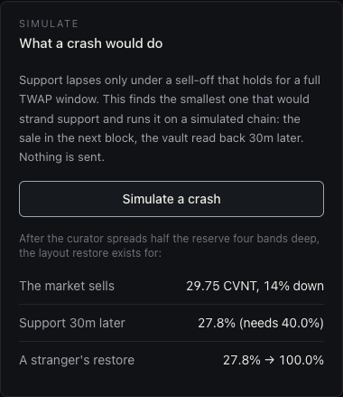

# Covenant — the app

The web app for [Covenant](../README.md). It runs on the real contracts: every number on its pages is read from the
chain, every action is a transaction, and every refusal is the contract's own custom error, decoded.

## Run it

From the repository root:

```bash
make demo
```

It needs Foundry (`forge`, `anvil`) and Node 22.14 or newer (24 recommended, as in `.nvmrc`). In a few seconds it does the following:

1. Starts Anvil on `127.0.0.1:8545` with a deterministic setup: a fixed genesis time, one second per block and no
   fees.
2. Deploys Uniswap v4, the Liquidity Launcher's `LBPStrategy`, the CCA factory and Covenant from the repository's
   pinned sources (`script/LocalStack.s.sol`).
3. Runs one real launch with the app's own launch code: vault, CCA auction, bids, migration, adoption and the
   demand-shaped seed. It then funds a bounty and takes a baseline snapshot.
4. Starts the app on http://localhost:3000/?net=local. Without `?net=`, a browser that has not picked a network opens
   the live Base Sepolia deployment, if it answers.

Ctrl-C stops both. Inside `web/` the same pieces run separately: `npm run chain` starts the chain, `npm run dev`
starts the app.

## Pages

| Page | On-chain |
|---|---|
| `/` | The landing page. Its figures are recorded from the contracts, so it works with no chain running (`npm run record`) |
| `/vault` | Everything about a vault from `CovenantLens.snapshot`, plus its event history |
| `/launch` | Create a vault, verify the launch with `verifyLaunch`, bid in the CCA, close, migrate, adopt, seed |
| `/curate` | A cut-and-leg editor. Each edit runs `eth_simulateV1` with `[reshape, lens.snapshot]`, so the verdict and the chart are exactly what the contract would do |
| `/keep` | Restore with a pre-flighted bounty, a crash button that finds the smallest sell-off that strands support, and `poke` |
| `/provide` | In-kind deposits and exits at the simulated cost, fee claims, and the issuer's principal |
| `/govern` | The curator timelock, the issuer transfer, fees and the bounty pool |
| `/attacks` | The 20 attacks from `AttackCatalogue.t.sol` and `PumpRatchet.t.sol`, each in its own snapshot |
| `/demo` | The 10 steps of `LaunchToRelease.t.sol`. A snapshot is taken before each step, so any step can be run again |

The dock at the bottom moves chain time, trades against the pool and resets the chain to the baseline. The role
switcher signs as the issuer, curator, keeper, an outside LP or a holder. These are Anvil's public dev keys, and
`src/chain/accounts.ts` refuses them on any chain but 31337.

## How it is built

```
src/chain/        the contract layer, shared by the browser and the Node scripts
  abi.generated   typed ABIs from ../out, with one merged error ABI (npm run abi)
  launch.ts       the launch, step by step (UniswapStack._register, _bid, _closeAndMigrate)
  plans.ts        reshape legs (CovenantTestBase._honestLegs, _bid, _ask) and the hostile plans
  view.ts         VaultView: the lens snapshot as display numbers
  preflight.ts    eth_simulateV1: the revert, or the exact state an action would leave
  errors.ts       every custom error, with the rule it belongs to and a plain-English reason
  scenarios/      the guided demo, the attack lab and the crash-and-restore probe
src/store/chain.ts  network, current vault, view, role, a serialized transaction queue, the activity log
src/app/api/chain   the deployment manifest, and reset to the baseline snapshot
scripts/          chain.ts (bring-up), demo.ts (chain and app), record.ts (landing fixtures), gen-abi.ts
```

Pre-flights run against the `pending` block, which is where the transaction will actually land: the next block
number and the next second. Time- and block-gated checks therefore agree with the transaction. When a call would
revert, the scripted scenarios only pre-flight it, the way `vm.expectRevert` does. A submit from the UI sends it
anyway, so it is mined as a failed transaction with a hash.

## Test

```bash
npm test            # unit tests: price maths, error decoding, launch helpers, terms, networks, log scans, RPC retries
npm run test:chain  # the guided demo and the attack lab against a dedicated chain on :8546
npm run test:fork   # the public-chain code path (:8550), and the three proof runners on forks of their own (:8551–8552); needs network
npm run lint && npm run build
```

`npm run test:chain` asserts the same outcomes as the Solidity tests it replays:
- the demo steps' reverts: `InsufficientShares`, `IdleTooLarge`, `SupportBroken`, `PriceGuard`, `TimelockActive`,
  `Locked`;
- the crash and the restore;
- every attack in the lab blocked.

## Base Sepolia

The app reads and signs on three networks, picked at the top of every page (a `?net=` link opens one directly):

| Network | Signs with | Started by |
|---|---|---|
| Local chain | Anvil's dev keys, one per role | `make demo` or `npm run chain` |
| Base Sepolia | your browser wallet (EIP-6963; MetaMask, Rabby, Coinbase Wallet) | already deployed and launched (below) |
| Base Sepolia fork | your wallet, on a local fork of the live chain | `make fork` |

Covenant is live on Base Sepolia. `deployments/84532.json` holds its contracts and `deployments/84532.runtime.json`
its first launch, the CVNT vault, so http://localhost:3000/vault?net=base-sepolia opens that vault with no setup and no
wallet. The root README lists the addresses. A new deployment is `make deploy-sepolia`, then `make launch-sepolia`.

On Base Sepolia and its fork, there are three rules:
- **Your wallet signs everything.** The role switcher shows which roles your address really holds.
- **A call that would revert is never sent.** Its decoded error is shown instead, so a refusal costs no gas.
- **An action your wallet cannot take is simulated, not sent.** A reshape when you are not the curator runs as the vault's real curator, so the verdict is exact; only the curator's wallet can send it.

The local-chain tools need a clock that can jump: time travel, the attack lab and the guided demo. On a public chain they show the recorded runs and offer to switch. Crashes are the exception: on a public chain, Keep simulates the smallest sell-off that would strand support, the sale in one simulated block and the vault read back a TWAP window later (`src/chain/crashsim.ts`). Nothing is sent.



- **Logs.** Public RPCs cap a single log scan (Base Sepolia's at 200 blocks). Discovery and history read a bounded recent window in 200-block spans, then only new blocks (`src/chain/logs.ts`). Launches older than that window come from `deployments/84532.runtime.json`, which the launch script writes. Their first 600 blocks, and any spans the runtime record lists (the live proof's), are read once, so the vault's own story stays in its activity feed.
- **The launch runner** (`scripts/launch-public.ts`, behind `make launch-sepolia`) is resumable. Every step is recorded in `deployments/84532.launch.json` as it lands and checked against the chain before it runs again.
- **The live proof** (`scripts/proof-public.ts`, behind `make proof-sepolia`) runs Covenant's rules as real transactions against the CVNT vault and records each in `deployments/84532.proof.json`. Before it sends anything it simulates the whole plan, including the crash: `src/chain/crashsim.ts` finds the smallest sell-off that strands support once it has held for the TWAP window, with one `eth_simulateV1` of two blocks (the sale, then the vault a window later), so no snapshots are needed. `npm run proof -- --rehearse` runs it on a fork of Base Sepolia as it is now; `--check` only simulates. `--lp` runs the LP proof instead (`scripts/lib/lpproof.ts`): an outside LP joins in kind, earns its share of the fees and leaves in kind, recorded in `deployments/84532-lp.proof.json`. Deposits stay closed for a vault's first epoch, so it runs against CVLP, a second launch made with the contract's minimum one-hour epoch (`npm run launch -- --epoch 3600 --no-default`). `--manage` runs the management proof (`scripts/lib/manageproof.ts`): a pump; the curator's chase above the Anchor, refused with `BidAboveCeiling`; a re-centre capped at the ceiling, which settles within Pace; and moving everything in the same epoch, refused with `PaceExceeded`. Recorded in `deployments/84532-manage.proof.json`. Every runner saves each transaction's hash the moment it is broadcast (`scripts/lib/runkit.ts`), so a rerun after a crash never sends a step twice.
- **The RPC.** The browser uses the public endpoint unless `NEXT_PUBLIC_BASE_SEPOLIA_RPC_URL` names another. `BASE_SEPOLIA_RPC_URL` in `.env` is for the scripts and is never sent to the browser. The public endpoint answers more than 25 calls a second with error -32007 or HTTP 429; the app backs off and retries both (`patient` in `src/chain/client.ts`). For heavy use, set your own endpoint.

### Hosted

The app is live at **https://covenant-uhi11.vercel.app**, reading Base Sepolia. Without a wallet it shows everything,
and Curate's pre-flight still gives the contract's exact verdict. Connect a wallet to act.

- **One network.** `COVENANT_NETWORKS=base-sepolia` (a server env, comma-separated) limits the networks the server
  offers. Unset, it offers all three. A link to a network it does not offer opens the first one it does.
- **Records in the bundle.** The API routes read `deployments/` beside `web/`, so `outputFileTracingRoot` is the
  repository root and Next.js traces Base Sepolia's records into the functions.
- **What is uploaded.** The repository-root `.vercelignore` lets through `web/` and `deployments/84532*.json` only:
  never `.env`, `lib/`, `out/` or `broadcast/`.
- **Deploying.** From the repository root, with the Vercel project's root directory set to `web`:
  `vercel deploy --prod`.
